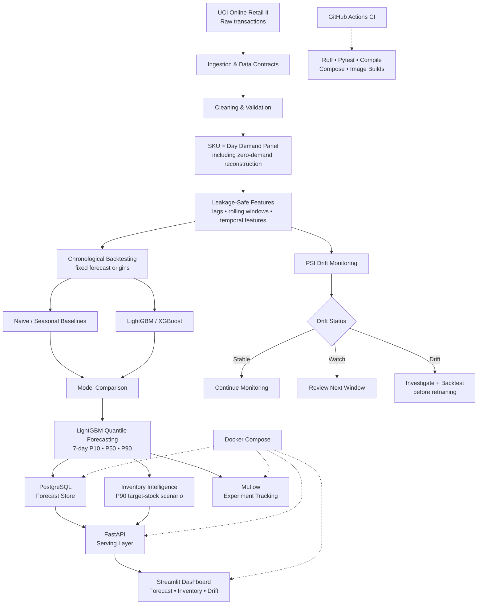

# DemandPilot

> **Production-grade probabilistic demand forecasting and inventory intelligence — from raw retail transactions to monitored decisions.**

DemandPilot is an end-to-end ML engineering system built to answer a practical retail question:

**How much demand should we expect for each SKU over the next 7 days, how uncertain is that forecast, and how can the forecast support safer inventory decisions?**

Instead of stopping at a notebook or point prediction, DemandPilot implements the full path from data validation and leakage-safe forecasting to probabilistic uncertainty, inventory policy, experiment tracking, persistence, APIs, dashboarding, drift monitoring, containers, and CI/CD.

---

## Business problem

Retail demand is noisy and asymmetric. Under-forecasting can create stockouts and lost sales; over-forecasting can create excess inventory and holding cost. A single point forecast also hides uncertainty exactly where planners need it most.

DemandPilot therefore solves four connected problems:

1. forecast **7-day SKU demand** without future-data leakage;
2. quantify uncertainty with **P10 / P50 / P90** forecasts;
3. translate uncertainty into an auditable **inventory decision scenario**;
4. expose and monitor the system through production-style ML infrastructure.

## Solution at a glance

| Problem | DemandPilot approach |
| --- | --- |
| Transaction data is not forecast-ready | Validate, clean, aggregate, and reconstruct a SKU × day demand panel |
| Random splits leak temporal information | Use chronological splits and fixed forecast origins |
| Point forecasts hide risk | Train LightGBM quantile models for P10, P50, and P90 |
| Forecasts alone do not support replenishment | Use P90 as a service-oriented target-stock scenario when real on-hand inventory is supplied |
| Experiments are difficult to reproduce | Track experiments with MLflow and version configuration/code |
| Predictions need a serving contract | Persist forecasts in PostgreSQL and expose them through FastAPI |
| Stakeholders need an operational view | Provide Streamlit forecast, inventory, and drift views |
| Models can degrade after deployment | Monitor numeric feature drift with PSI and explicit alert actions |
| ML systems need release discipline | Run tests, linting, compilation, Compose validation, and image builds in CI |

---

## End-to-end architecture



### Architecture boundaries

**Offline ML path:** raw transactions → validated demand panel → past-only features → chronological evaluation → probabilistic forecasts.

**Decision path:** forecast quantiles → real on-hand inventory input → inventory recommendation. The source dataset does **not** contain a trustworthy current inventory ledger, so DemandPilot never fabricates on-hand stock.

**Online serving path:** PostgreSQL → FastAPI → Streamlit. Training and model selection stay outside the request path.

**Operations path:** PSI monitoring → stable/watch/drift → investigation gate. Drift never triggers blind automatic retraining or model promotion.

For the engineering-level architecture, see [`docs/architecture.md`](docs/architecture.md).

---

## Forecasting methodology

### 1. Forecast target

The operational target is **total SKU demand during the 7 days after a forecast origin**.

Every feature at an origin is computed only from information available **before** that origin. This keeps the training and evaluation contract aligned with how a real forecast would be generated.

### 2. Chronological evaluation

| Stage | Period / contract |
| --- | --- |
| Training ends | **2011-10-14** |
| Validation | **2011-10-15 → 2011-11-11** |
| Locked test | **2011-11-12 → 2011-12-09** |
| Forecast horizon | **7 days** |
| Primary point metric | **WAPE** |
| Probabilistic outputs | **P10 / P50 / P90** |
| Interval evaluation | **P10-P90 empirical coverage** |

The locked test period is excluded from model selection. Results below are validation evidence, not claims of live commercial performance.

### 3. Probabilistic forecasting

DemandPilot uses **LightGBM quantile regression**:

- **P10** — lower-demand scenario;
- **P50** — median / central forecast;
- **P90** — higher-demand service scenario.

This makes forecast uncertainty explicit instead of treating a single prediction as certain.

---

## Verified results

Across **11,427 SKU-origin forecasts** and four weekly validation origins:

| Metric | Result |
| --- | ---: |
| Seasonal 7-day baseline WAPE | **0.772276** |
| LightGBM P50 WAPE | **0.601275** |
| Relative WAPE improvement | **~22.1%** |
| P10-P90 empirical coverage | **84.44%** |

The result demonstrates improvement over the seasonal benchmark while preserving an explicit uncertainty interval.

> The repository deliberately distinguishes validation evidence from production performance. No live-retailer performance claim is made.

---

## Inventory intelligence

A good forecast is not automatically a good replenishment decision. DemandPilot keeps the decision layer explicit and auditable.

P90 represents a **service-oriented target-stock scenario**, while **P90 − P50** provides an uncertainty-derived safety-stock proxy. Executable reorder recommendations require actual on-hand inventory and applicable business constraints such as MOQ.

Because Online Retail II does not provide trustworthy current on-hand inventory, the project does not invent it.

---

## Production ML / MLOps layer

| Component | Responsibility |
| --- | --- |
| **MLflow** | experiment tracking |
| **PostgreSQL** | forecast persistence |
| **FastAPI** | health, readiness, forecast, and inventory APIs |
| **Streamlit** | forecast, inventory, and drift decision interface |
| **PSI monitoring** | deterministic feature-distribution monitoring |
| **Docker Compose** | integrated local runtime |
| **GitHub Actions** | automated quality and container gates |
| **Ruff + Pytest** | static quality and behavioral regression protection |

API and dashboard images run as an **unprivileged `demandpilot` user** rather than root.

---

## Monitoring and model governance

Numeric feature drift is classified with deterministic PSI thresholds:

| PSI | Status | Operational action |
| ---: | --- | --- |
| **< 0.10** | Stable | continue monitoring |
| **0.10 – < 0.25** | Watch | review the next window |
| **≥ 0.25** | Drift | investigate before retraining |

A drift signal is evidence to investigate, **not permission to automatically replace the model**. Any replacement should pass fresh chronological backtesting and release quality gates.

See [`docs/model_card.md`](docs/model_card.md) for intended use, limitations, risks, and governance.

---

## Repository structure

```text
demandpilot-probabilistic-forecasting/
├── configs/                 # data, modeling, forecasting configuration
├── dashboard/               # Streamlit UI + API client
├── data/                    # raw/interim/processed zones (data excluded from Git)
├── docker/                  # API, dashboard, and MLflow images
├── docs/                    # architecture, methodology, operations, model card
├── notebooks/               # focused analysis/audit notebook
├── reports/                 # reproducible quality summaries / generated outputs
├── scripts/                 # benchmark, database, monitoring, operational entry points
├── src/demandpilot/
│   ├── api/                 # FastAPI layer
│   ├── data/                # ingestion, validation, demand construction
│   ├── db/                  # persistence contract
│   ├── features/            # leakage-safe feature engineering
│   ├── inventory/           # inventory policy
│   ├── models/              # baselines, boosting, probabilistic forecasting
│   └── monitoring/          # PSI reporting and alert policy
├── tests/                   # automated data/ML/platform/monitoring tests
├── .github/workflows/       # CI
├── docker-compose.yml
└── pyproject.toml
```

Detailed ownership: [`docs/repository_map.md`](docs/repository_map.md).

---

## Run the platform locally

### Prerequisites

- Docker Desktop / Docker Engine with Compose
- Git

### Start

```bash
git clone https://github.com/rjraunak04/demandpilot-probabilistic-forecasting.git
cd demandpilot-probabilistic-forecasting
docker compose up -d --build
```

For local database credentials, copy `.env.example` and replace the example password. Never commit real credentials.

### Services

| Service | Local endpoint |
| --- | --- |
| FastAPI | `http://localhost:8000` |
| Swagger / OpenAPI | `http://localhost:8000/docs` |
| MLflow | `http://localhost:5000` |
| Streamlit | `http://localhost:8501` |

Health contracts include API `/health`, database-aware API `/ready`, and Streamlit `/_stcore/health`.

---

## Quality gates

```bash
python -m ruff check .
python -m pytest -q
python -m compileall -q src scripts dashboard
docker compose config --quiet
```

The accepted release baseline has **200 passing tests** with one known non-blocking SQLAlchemy/MLflow deprecation warning. GitHub Actions also validates Python 3.11/3.12 quality gates and builds the API/dashboard serving images.

---

## Engineering documentation

| Document | Purpose |
| --- | --- |
| [Architecture](docs/architecture.md) | system flow and ML/serving/operations boundaries |
| [Model card](docs/model_card.md) | intended use, evidence, limitations, governance |
| [Deployment](docs/deployment.md) | runtime and deployment contract |
| [Probabilistic forecasting](docs/day04_probabilistic_inventory.md) | 7-day quantile and inventory methodology |
| [Monitoring](docs/day06_monitoring.md) | drift methodology |
| [Operations](docs/day06_operations.md) | monitoring operations and alert behavior |
| [CI/CD](docs/day07_cicd.md) | quality and release gates |
| [Release checklist](docs/release_checklist.md) | final acceptance criteria |

---

## What this project demonstrates

DemandPilot is intentionally broader than a forecasting notebook. It demonstrates:

- time-aware ML evaluation and leakage prevention;
- probabilistic forecasting rather than point prediction only;
- baseline-first model comparison;
- uncertainty-aware business decision design;
- separation of training, serving, and monitoring responsibilities;
- reproducible configuration and automated tests;
- experiment tracking and database persistence;
- API and dashboard integration;
- drift governance without unsafe auto-retraining;
- containerized runtime and CI/CD quality gates.

## Limitations and production extensions

DemandPilot is a **production-oriented engineering project**, not a claim of a live commercial deployment. A real retailer rollout would additionally require current inventory and lead-time feeds, retailer-specific promotion/price/holiday signals, authentication and authorization, TLS, managed secrets, backups, autoscaling, centralized observability, and business approval workflows.

Those are deployment-context extensions rather than missing requirements for the portfolio scope of this repository.

---

## Status

**Complete.** DemandPilot covers the full portfolio scope from raw retail data to probabilistic forecasting, inventory intelligence, serving, monitoring, CI/CD, and deployment hardening.

The implementation, architecture, model card, tests, and release contracts are versioned in this repository.
